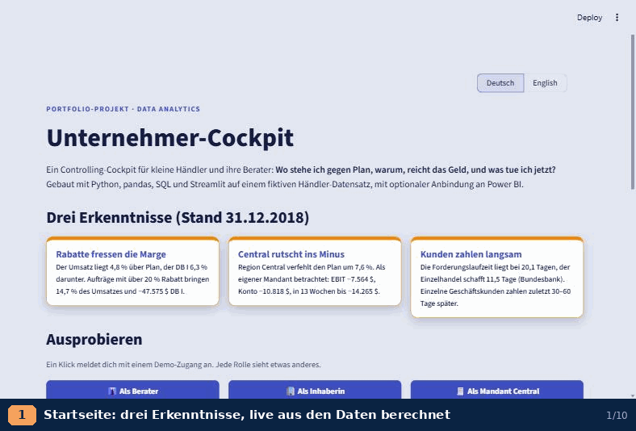
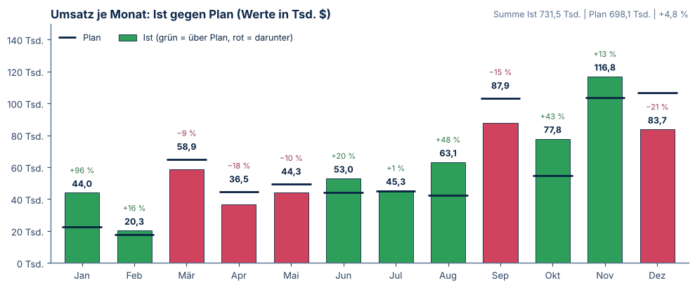
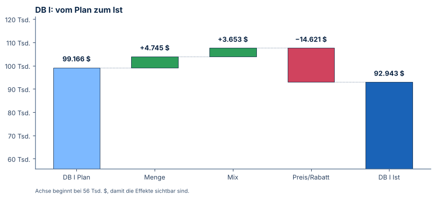
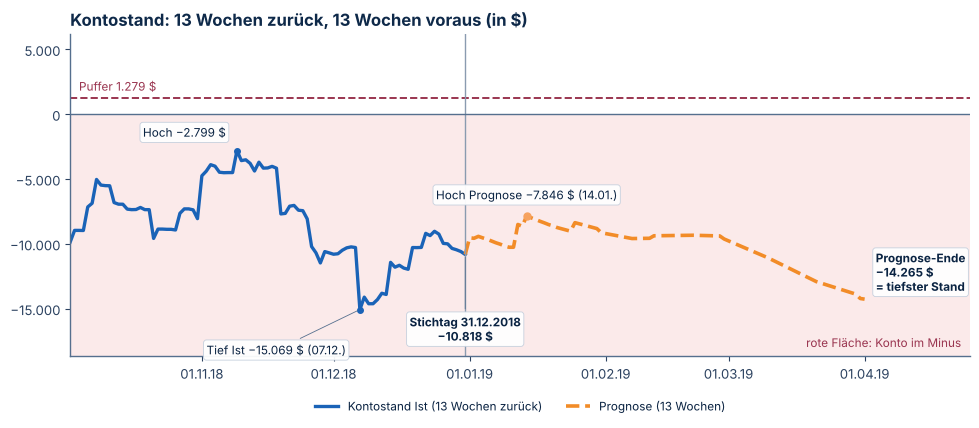
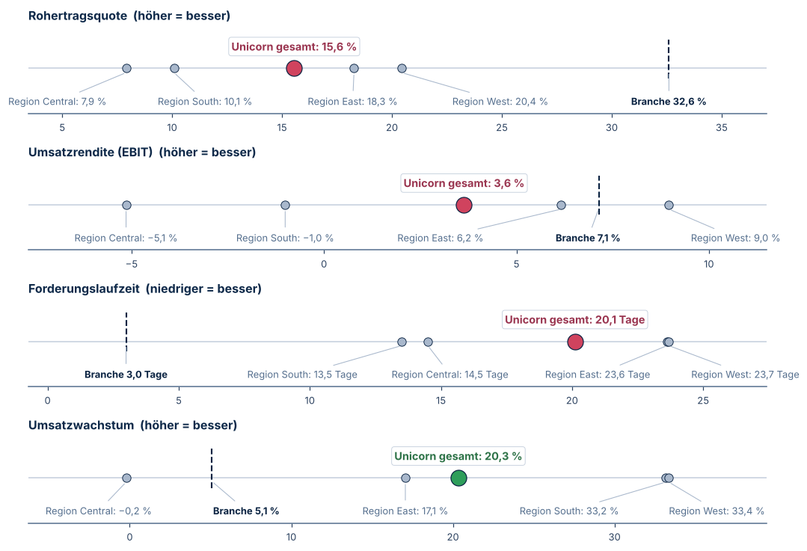
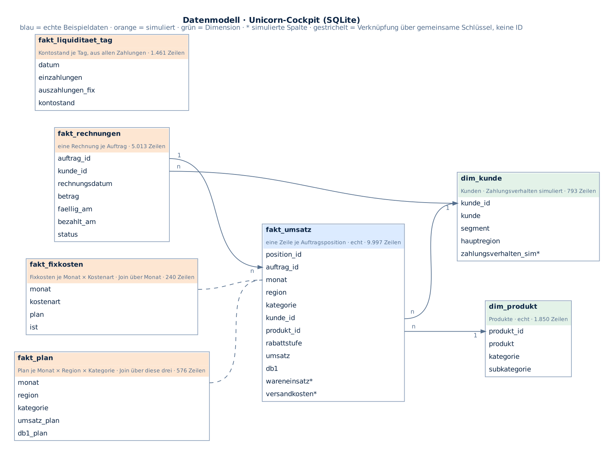

# Unternehmer-Cockpit · Business Cockpit

[🇬🇧 English](README.md) · 🇩🇪 Deutsch

[](../../actions/workflows/tests.yml)

## Der Umsatz liegt über Plan. Warum wird trotzdem das Geld knapp?

Ein Händler übertrifft seinen Umsatzplan um **4,8 %** – und verfehlt den Deckungsbeitrag trotzdem um **6,3 %**. Eine
Region steht als eigener Mandant schon im Minus, die Kunden zahlen fast doppelt so langsam wie im Branchenschnitt. Dieses
Cockpit findet heraus, warum, zeigt, was als Nächstes passiert, und macht aus jeder Warnung eine Maßnahme – für die vier
Fragen, die sich eine Unternehmerin jeden Montag stellt:
*Wo stehe ich gegen Plan? Warum? Reicht das Geld? Was tue ich jetzt?*

**Live-Demo:** _Link folgt nach dem Online-Stellen_ – ein Klick meldet dich als Berater, Inhaberin oder Mandant an.
Das kostenlose Hosting legt die App nach einer Weile schlafen; der erste Aufruf kann rund 30 Sekunden dauern.

**Gebaut mit** SQL (SQLite, Export aus PostgreSQL), Python, pandas, matplotlib, Streamlit, optional Power BI Desktop
als Datenquelle · zweisprachig (Deutsch/Englisch) · 21 automatische Tests.



**Direkt zu:** [SQL-Abfragen](sql/) · [Kennzahlen und Datenherkunft](docs/kennzahlen.md) ·
[Datenmodell](docs/datenmodell_de.png) · [Entscheidungen und Grenzen](#entscheidungen-und-grenzen)

## Drei Erkenntnisse

| | Befund (Stand 31.12.2018) |
|---|---|
| 💸 Rabatte fressen die Marge | Umsatz **+4,8 %** gegen Plan, DB I **−6,3 %**. Aufträge mit über 20 % Rabatt bringen 14,7 % des Umsatzes und **−47.575 $** DB I. |
| 📉 Central rutscht ins Minus | Region Central verfehlt den Plan um **7,6 %**. Als eigener Mandant: EBIT −7.564 $, Konto −10.818 $, in 13 Wochen bis −14.265 $. |
| ⏳ Kunden zahlen langsam | Forderungslaufzeit **20,1 Tage**, der deutsche Einzelhandel schafft 11,5 Tage (Bundesbank). |






> Alle Unternehmens- und Kundendaten sind **fiktiv** (Tableau „Sample Superstore“, im Masterschool-Kurs als
> SQL-Datenbank „Unicorn“). Plan, Fixkosten und Zahlungen sind zusätzlich simuliert.

## SQL, Datenmodell und Kennzahlen

Die App rechnet mit pandas. Die wichtigsten Zahlen gibt es zusätzlich als lesbares SQL in [`sql/`](sql/) –
Kennzahlen gegen Plan, Rabattstufen, Regionen mit Ranking per Fensterfunktion, Forderungslaufzeit, Kontostand,
Kunden mit wachsendem Zahlungsverzug. Ein Test prüft, dass SQL und pandas dieselben Zahlen liefern; in der App zeigt
**„SQL hinter diesen Zahlen“** jede Abfrage mit ihrem Ergebnis.



Jede Kennzahl ist in [`docs/kennzahlen.md`](docs/kennzahlen.md) definiert, dazu, welche Daten echt und welche simuliert sind.


## Entscheidungen und Grenzen

- **Simulierte Teile.** Die Quelldaten enthalten nur Aufträge, Rabatte und Gewinn. Plan, Fixkosten, Zahlungsziele,
  Zahlungsverhalten und Kontostand sind simuliert (Seed 42, reproduzierbar). Einige Warnsignale sind bewusst
  eingebaut, damit das Cockpit etwas zeigen kann; das Margenproblem durch Rabatte stammt aus den echten Beispieldaten.
- **DB I** ist die Gewinnspalte des Datensatzes (Umsatz − Wareneinsatz − Versand); die Aufteilung zwischen Ware und
  Versand ist eine Annahme je Versandart.
- **Umlage.** Fixkosten, Entnahme und Startkasse sind Firmenwerte und werden im Mandanten-Modus nach Planumsatz
  verteilt; die vier Mandanten ergeben zusammen genau die Firma (getestet).
- **Benchmark.** US-Händler gegen deutschen Einzelhandel: Quoten vergleichbar, Beträge nicht. Der Unternehmerlohn
  fehlt, Personalquote und Umsatzrendite sehen dadurch besser aus, als sie sind.
- **Wachstum** erscheint erst, wenn 12 volle Vergleichsmonate vorliegen (ab 12/2016).
- **Online-Demo.** Niemand speichert etwas für andere: Maßnahmen gelten nur in der Sitzung, Schwellen sind fest,
  Power BI und KI werden durch Erklärungen und regelbasierte Beispielantworten ersetzt
  (`COCKPIT_DEMO = "1"` als Umgebungsvariable oder in den Streamlit-Secrets).

## Was ich gelernt habe und was als Nächstes käme

- **Von der Frage her bauen, nicht vom Diagramm.** Die vier Montagsfragen haben jede Seite bestimmt; was keine davon
  beantwortet, ist rausgeflogen.
- **Zahlen doppelt prüfen, in zwei Sprachen.** Jede Kennzahl wird in Python und noch einmal in reinem SQL gerechnet,
  ein Test vergleicht beide. Das hat echte Unterschiede aufgedeckt, z. B. dass SQLite und Python halbe Werte
  unterschiedlich runden.
- **Offen sagen, was simuliert ist.** Plan, Kosten und Zahlungen sind erzeugt; README, App und Datendokumentation
  sagen das mit denselben Worten, damit niemand raten muss, welche Erkenntnis aus echten Daten stammt.
- **Für Besucher mit zwei Minuten bauen.** Drei Erkenntnisse auf der Startseite, Ein-Klick-Anmeldung und ein kurzer
  Rundgang bringen mehr als eine weitere Funktion.

**Nächste Schritte:** im Rückblick zeigen, wie gut die Liquiditätsprognose war · Branchenvergleich mit US-Handelszahlen ·
Montags-Briefing als PDF · Anbindung an einen echten Buchhaltungsexport.

## Für Entwickler

Lokale Streamlit-App auf den Unicorn-Daten. Datenquelle (oben links umschalten): die SQLite-Datei
`../10_cockpit_daten/unicorn_cockpit.sqlite` (online: `daten/unicorn_cockpit.sqlite`) oder ein geöffnetes **Power-BI-Desktop**-Modell.
Zwei Modi (oben links umschalten): **intern** = eine Firma, **extern** = Berater mit vier Mandanten.

## Starten

1. In VS Code den Ordner `11_cockpit_app` öffnen, Terminal öffnen.
2. Einmalig die Pakete installieren:
   ```
   python -m pip install -r requirements.txt
   ```
3. App starten:
   ```
   python -m streamlit run app.py
   ```
   Der Browser öffnet sich unter http://localhost:8501.

Unter Windows geht auch ein Doppelklick auf `start_cockpit.bat`.

Liegt die Datenbank woanders, setze vor dem Start die Variable `COCKPIT_DB`:
```
set COCKPIT_DB=C:\pfad\zu\unicorn_cockpit.sqlite
```

## Power BI Desktop als Datenquelle (Schritt 4)

Solange eine .pbix in Power BI Desktop geöffnet ist, läuft darin ein lokaler Analysis-Services-Server.
Die App findet ihn automatisch und holt die sechs Tabellen per DAX (`EVALUATE 'tabelle'`).

**Einmalig einrichten**

1. Paket installieren: in der App **Power BI Desktop** wählen und auf **pythonnet jetzt installieren** klicken.
   Oder im Terminal im Ordner `11_cockpit_app`:
   ```
   python -m pip install -r requirements-powerbi.txt
   ```
   Für Python 3.14 braucht es pythonnet 3.2 oder neuer.
2. Power BI Desktop öffnen → **Daten abrufen → Excel-Arbeitsmappe** →
   `10_cockpit_daten/unicorn_cockpit_powerbi.xlsx`.
3. Im Navigator alle sechs Blätter anhaken → **Laden**. Tabellen- und Spaltennamen nicht umbenennen.
4. Speichern, z. B. als `10_cockpit_daten/unicorn_cockpit.pbix`.

**Benutzen**

1. Die .pbix in Power BI Desktop öffnen und offen lassen.
2. In der App oben links **Datenquelle: Power BI Desktop** wählen.
3. Die Box **Abgleich mit SQLite** zeigt je Tabelle, ob Power BI dieselben Zahlen liefert.
4. Nach Änderungen in Power BI (z. B. **Aktualisieren**) in der App **↻ Neu verbinden** klicken.

Der Schalter **Inhalt des Power-BI-Modells zeigen** listet alle Tabellen des geöffneten Modells mit Spalten,
Zeilenzahl und drei Beispielzeilen. Sind mehrere .pbix offen, wählst du das Modell in der Seitenleiste. Ist keins offen oder klappt die
Verbindung nicht, zeigt die App eine Meldung und rechnet weiter mit der SQLite-Datei.

Zusätzliche Spalten, Measures oder Visuals im Power-BI-Modell stören nicht; die App liest nur die
Spalten, die sie braucht. Findet die App die Power-BI-Bibliothek nicht, setze vor dem Start:
```
set COCKPIT_ADOMD_DLL=C:\Program Files\Microsoft Power BI Desktop\bin\Microsoft.AnalysisServices.AdomdClient.dll
```
Die Excel-Datei lässt sich aus der SQLite-Datei neu schreiben: `python quelle.py excel` (braucht einmalig `pip install openpyxl`).

### Daten und Datenschutz

Die Unicorn-Daten sind ein **fiktiver Übungsdatensatz**: Sie entsprechen dem „Sample Superstore“ von Tableau
(793 Kunden, Regionen Central/East/South/West), im Masterschool-Kurs als Datenbank „Unicorn“ aufbereitet.
Plan, Fixkosten, Zahlungsziele, Zahlungsverhalten und Kontostand sind zusätzlich simuliert. Die Kundennamen
gehören zu keinen echten Personen.

Für echte Firmendaten wäre zusätzlich nötig: Zugänge mit eigenen Passwörtern (siehe unten), Auftragsverarbeitungs-
verträge mit jedem Dienst, der Daten verarbeitet (z. B. die KI-API), Datensparsamkeit (Schalter
**Kundennamen pseudonymisieren**: ersetzt Namen überall durch „Kunde 0123“, auch in Fragen an die KI),
Löschfristen und ein Betrieb hinter HTTPS statt nur lokal.

### Zugänge und Rollen

| Rolle | sieht |
|---|---|
| Berater | alles: intern und extern, alle Mandanten, Mandanten-Übersicht, Datenquelle |
| Inhaber | nur die eigene Firma (interner Modus); darf Datenquelle und Schwellen ändern |
| Mandant | nur seinen Mandanten; andere Mandanten nur anonym im Benchmark; Schwellen nur ansehen |

Die Zugänge stehen in `zugaenge.json` (Passwörter nur als PBKDF2-Hash mit Salz). Mitgeliefert sind
**Demo-Zugänge** für das Portfolio; sie stehen offen auf der Anmeldeseite:
`berater / demo-berater`, `inhaber / demo-inhaber`, `central / demo-central` (ebenso `east`, `south`, `west`).

```
python zugang.py demo                          Demo-Zugänge neu schreiben
python zugang.py anlegen anna mandant West     eigenen Zugang anlegen (Passwort wird abgefragt)
python zugang.py liste
python zugang.py loeschen central
```
Ohne `zugaenge.json` startet die App ohne Anmeldung (wie bisher).

### Tests

```
python -m pip install pytest
python -m pytest -q
```
Die Tests prüfen die Kernzahlen (Umsatz, DB I, EBIT, Kontostand 2018), die Mandanten-Umlage, den Benchmark,
den Abgleich SQLite gegen Power BI, die Pseudonymisierung und die Zugänge. Schlägt ein Test fehl, hat eine
Änderung eine Zahl verschoben.

## Seiten

| Seite | Inhalt |
|---|---|
| Überblick | 4 KPI-Kacheln mit Ampel (Umsatz, DB I, EBIT, Kontostand), Lagetext, Monatsverlauf, Signale |
| Plan-Ist | DB-I-Wasserfall (Menge, Mix, Preis/Rabatt), Rabattstufen, Regionen, Kategorien, Fixkosten |
| Liquidität | Kontostand 13 Wochen zurück und voraus, Zahlungsverzug (Histogramm + Dichte), säumige Kunden |
| Was wäre wenn? | Hebel für Rabatt-Deckel, Mengenverlust, Umsatzmenge, Fixkosten, Zahlungsverzug; EBIT-Brücke, Break-even, Liquidität im Szenario |
| Frühwarnung | einstellbare Schwellen, Warnsignale der letzten 12 Monate, aus jedem Signal eine Maßnahme anlegen |
| Maßnahmen | Liste mit Verantwortlichem, Fälligkeit, Status und erwartetem EBIT-Effekt (gespeichert in `massnahmen.sqlite`) |
| Frag dein Cockpit | KI beantwortet Fragen zu den Zahlen (braucht `ANTHROPIC_API_KEY`) |
| Montags-Briefing | fertiger E-Mail-Text, als Entwurf im E-Mail-Programm öffnen oder herunterladen |
| Benchmark | 5 Kennzahlen (letzte 12 Monate) gegen den deutschen Einzelhandel (Bundesbank) und gegen die anderen Mandanten bzw. Regionen |
| Mandanten-Übersicht | nur extern: alle Mandanten mit Ampel, dringendstem Signal und Button „Öffnen“ |

## Externer Modus (Schritt 3)

- Jede Region (Central, East, South, West) ist ein Mandant „Unicorn <Region>“. Umsatz, Plan und Rechnungen
  gehören eindeutig zur Region.
- Fixkosten, Privatentnahme und Startkasse sind Firmenwerte. Sie werden per **Umlage nach Planumsatz** des
  Jahres verteilt (2015 ohne Plan: Ist-Umsatzanteil). Der Kontostand je Mandant wird aus seinen eigenen
  Zahlungsströmen neu berechnet. Die vier Mandanten ergeben zusammen genau die Firma.
- Maßnahmen werden je Mandant gespeichert (Spalte `mandant` in `massnahmen.sqlite`; bisherige Einträge
  gehören zum internen Modus).
- Im Benchmark sieht ein Mandant die anderen nur anonym (Mandant A, B, C). Namen zeigt nur die
  Mandanten-Übersicht für den Berater.

## Branchenwerte

Deutsche Bundesbank, Jahresabschlussstatistik (Hochgerechnete Angaben), Dezember 2025, Einzelhandel ohne Kfz
(WZ 47), S. 83–85. Werte 2015–2018 stehen in `logik.py` (`BRANCHE_ROH`). Rohertragsquote = 100 % − Materialaufwand,
Forderungslaufzeit = Forderungen aus L+L / Umsatz · 365. Vergleich nur als Übung: Unicorn ist ein US-Händler,
der Unternehmerlohn fehlt in den Personalkosten.

Oben links wählst du den **Stichtag** (Monatsende 01/2016 bis 12/2018). Alle Werte gelten
für das Jahr bis zu diesem Stichtag. Bei Stichtagen vor 10/2018 zeigt die Liquiditätsseite
zusätzlich, wie sich der Kontostand tatsächlich entwickelt hat, als Rückblick zur Prognose.

## Dateien

| Datei | Zweck |
|---|---|
| `app.py` | Oberfläche (Streamlit) |
| `logik.py` | alle Berechnungen und Signale, ohne Streamlit testbar |
| `diagramme.py` | Diagramme (matplotlib, CI-Farben, Dezimalkomma, Werte im Bild) |
| `massnahmen.py` | Maßnahmen speichern und laden |
| `ki.py` | Faktenzettel und Aufruf der Claude-API |
| `quelle.py` | Datenquellen SQLite und Power BI Desktop, Abgleich |
| `zugang.py` | Zugänge, Rollen, Passwort-Hashes |
| `sprache.py` | Texte Deutsch/Englisch und Zahlenformate |
| `sql/`, `sql_abfragen.py` | Kennzahlen als SQL-Abfragen, Ausführung für App und Tests |
| `daten/` | SQLite-Datenbank, Datendokumentation, Export-Abfrage und Generator (`erzeugung/`) |
| `docs/` | Kennzahlen, Datenmodell, Diagramme |
| `tests/test_cockpit.py` | automatische Tests |
| `einstellungen.json` | gespeicherte Schwellen (entsteht beim ersten Speichern) |

## Regeln und Schwellen (Standard in `logik.py`, änderbar unter Frühwarnung)

- Ampel: grün ≥ Plan, gelb bis −5 %, rot darunter
- Kontostand: rot unter 0, gelb unter Puffer (1 Monat Fixkosten + Entnahme)
- Fixkosten-Signal: Kostenart > +5 % über Plan in den letzten 4 Monaten (rot ab +15 %)
- Zahlungs-Signal: Kunde zahlt in den letzten 6 Monaten im Schnitt 20+ Tage später als in den 12 Monaten davor

## Datenhinweis

Umsatz, Menge, Rabatt und DB I stammen aus dem Unicorn-Projekt. Plan, Fixkosten,
Zahlungsziele, Zahlungsverhalten und Kontostand sind simuliert (Seed 42), siehe
[`daten/daten_dokumentation.md`](daten/daten_dokumentation.md).

## KI-Fragefeld einrichten

Schlüssel unter console.anthropic.com anlegen, dann im Terminal vor dem Start:
```
set ANTHROPIC_API_KEY=sk-ant-...
python -m streamlit run app.py
```
Optional anderes Modell: `set COCKPIT_MODELL=claude-haiku-5-5`. Die KI bekommt nur den Faktenzettel
(verdichtete Kennzahlen, Signale, Top-10 säumige Kunden mit Namen), keine Rohdaten.

## Datenschutz

Die Online-Demo zeigt ausschließlich fiktive Daten. Sie setzt keine eigenen Cookies, hat kein Tracking und sendet
keine Nutzungsstatistik (`gatherUsageStats = false`). Eingaben werden nur für die Dauer der Sitzung gehalten. Die App
läuft auf Streamlit Community Cloud; für Hosting und Server-Protokolle gilt deren Datenschutzerklärung.

Die Daten stammen aus einem öffentlichen Übungsdatensatz und sind teilweise simuliert, es sind keine echten Personen-
oder Kundendaten. Bei echten Daten arbeite ich nach den Grundsätzen der DSGVO: Anonymisierung, Datenminimierung und
beschränkter Zugriff.

## Kontakt und Lizenz

Projekt von **Denise Tirrel** · Data-Analytics-Portfolio · [LinkedIn](https://www.linkedin.com/in/denise-tirrel/) · [GitHub](https://github.com/denisetirrel-ops)

Code unter der [MIT-Lizenz](LICENSE). Die Umsatzdaten sind der fiktive Datensatz „Sample Superstore“ von Tableau
(im Masterschool-Kurs als „Unicorn“); Plan-, Kosten- und Zahlungsdaten sind simuliert.
