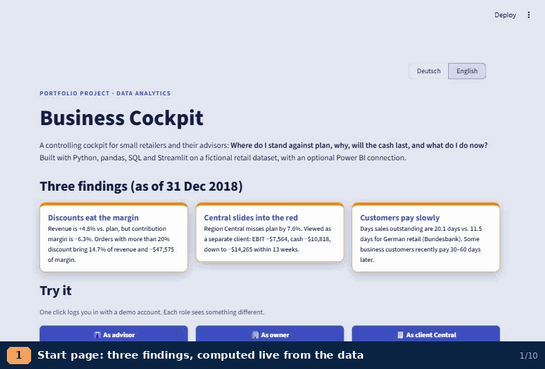
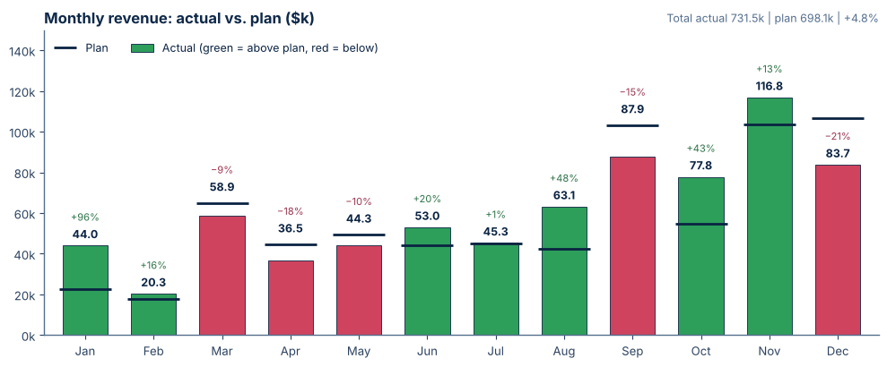
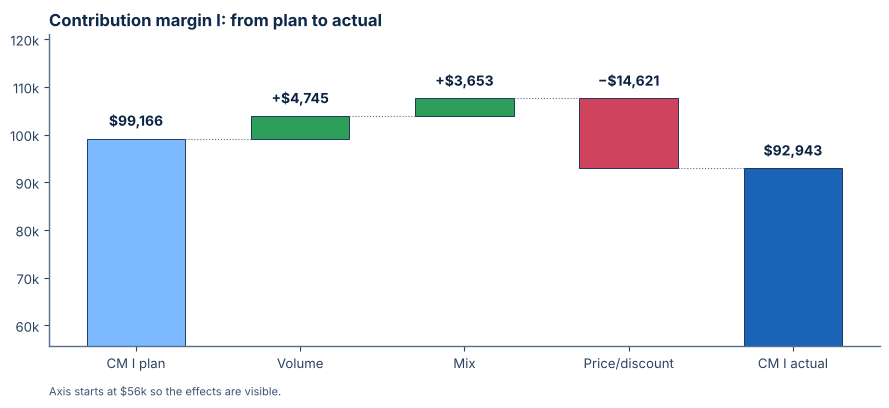
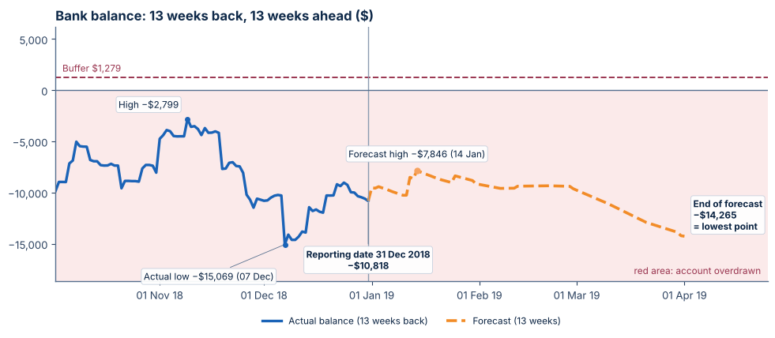
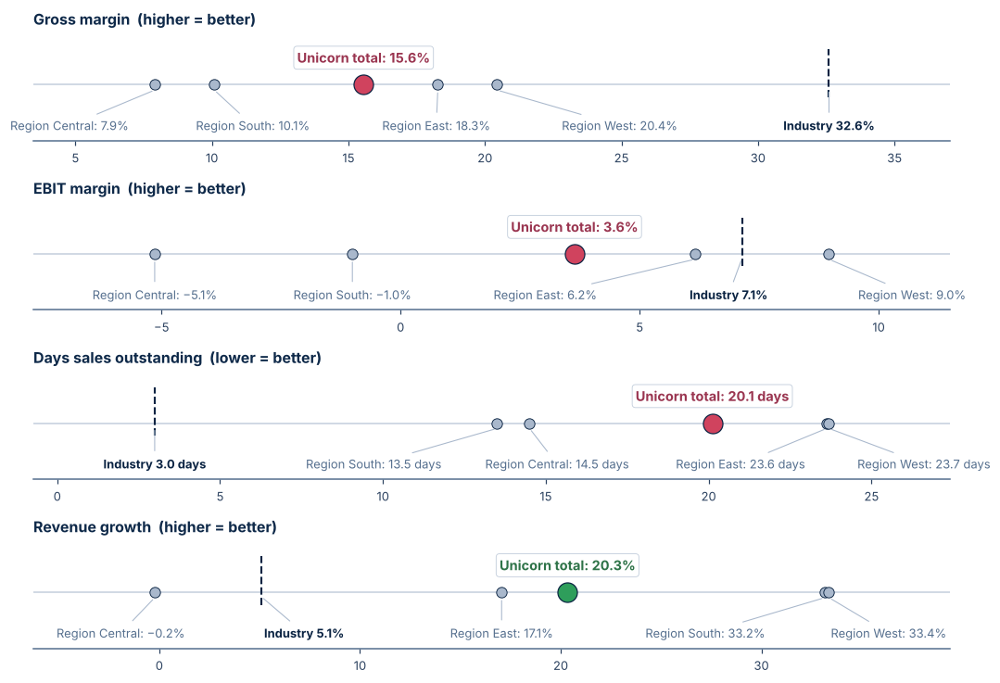
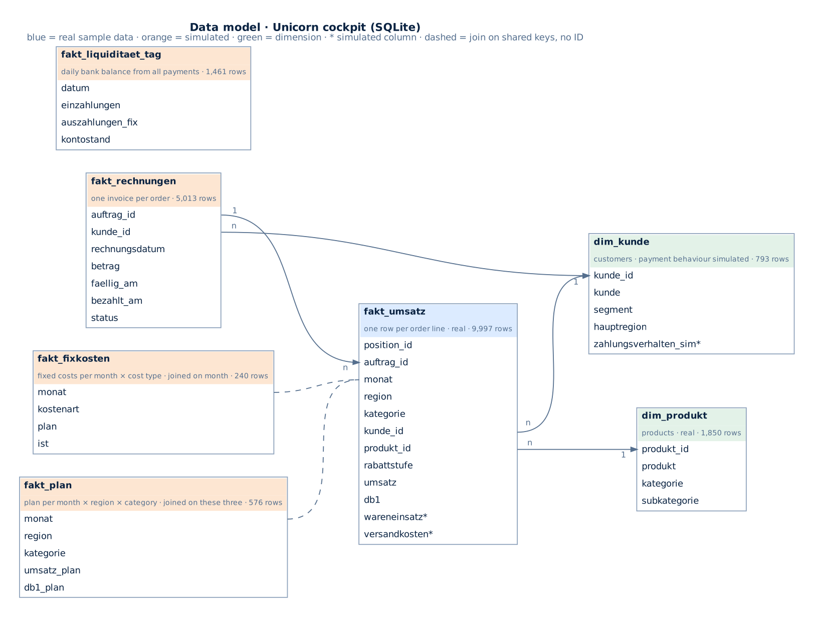

# Business Cockpit · Unternehmer-Cockpit

🇬🇧 English · [🇩🇪 Deutsch](README.de.md)

[](../../actions/workflows/tests.yml)

## Revenue is above plan. So why is the money running out?

A retailer beats its revenue plan by **4.8 %** – yet contribution margin misses plan by **6.3 %**, one region, run as its own
client, is already overdrawn and customers pay almost twice as slowly as the industry. This cockpit finds out why, shows what happens
next and turns every warning into an action – the four questions an owner asks every Monday:
*Where do I stand against plan? Why? Will the cash last? What do I do now?*

**Live demo:** [https://tirrel-business-dashboard.streamlit.app](https://tirrel-business-dashboard.streamlit.app/?lang=en) – one click logs you in as advisor, owner or client.
The free hosting puts the app to sleep after a while; the first visit can take about 30 seconds.

**Built with** SQL (SQLite, PostgreSQL export), Python, pandas, matplotlib, Streamlit, optionally Power BI Desktop as
data source · bilingual (German / English) · 21 automated tests.



**Quick links:** [SQL queries](sql/) · [metric definitions and data origin](docs/metrics.md) ·
[data model](docs/datenmodell_en.png) · [decisions and limits](#decisions-and-limits)

## Three findings

| | Finding (as of 31 Dec 2018) |
|---|---|
| 💸 Discounts eat the margin | Revenue is **+4.8 %** vs. plan, contribution margin **−6.3 %**. Orders with more than 20 % discount bring 14.7 % of revenue and **−$47,575** of margin. |
| 📉 Central slides into the red | Region Central misses plan by **7.6 %**. As a separate client: EBIT −$7,564, bank balance −$10,818, falling to −$14,265 within 13 weeks. |
| ⏳ Customers pay slowly | Days sales outstanding **20.1 days** vs. 11.5 days for German retail (Deutsche Bundesbank). |






> All company and customer data are **fictional** (Tableau “Sample Superstore”, used as the SQL database
> “Unicorn” in the Masterschool data analytics course). Plan, fixed costs and payments are simulated on top.

## SQL, data model and metric definitions

The app calculates with pandas. The key figures also exist as plain SQL in [`sql/`](sql/) – KPIs vs. plan, discount
levels, regions with a window-function ranking, days sales outstanding, bank balance, customers paying later. A test
checks that SQL and pandas give the same numbers, and in the app **“SQL behind these figures”** shows each query with
its live result.



Every metric is defined in [`docs/metrics.md`](docs/metrics.md), together with which parts of the data are real and
which are simulated.


## What the app does

- **Step 0 · Prepare data**: upload a CSV or Excel export with one row per order line. The app maps the columns,
  standardises dates, numbers and spellings, sets aside unusable rows with a reason and logs every change. Nothing is
  estimated or filled in. Afterwards the whole cockpit runs on the cleaned file, and an audit package (ZIP with
  cleaned data, change log, excluded rows, quality profile and SHA-256 manifest) plus an Excel file for Power BI can
  be downloaded. A practice file with typical export errors is included: after cleaning, every figure matches the
  SQLite database exactly. Whether 03/04/2018 means month/day or day/month is detected from the file itself (values
  like 25/03 allow only one reading). Exports are protected against formula injection.

  | Row | Field | Before | After | Rule |
  |---|---|---|---|---|
  | 2 | order date | `09/06/2015` | `2015-09-06` | R03 · month/day, detected from 3,504 unambiguous values |
  | 14 | sales | `518,00 $` | `518` | R04 |
  | 10 | profit | `(88)` | `-88` | R04 · brackets = minus |
  | 9 | discount | `20%` | `0.2` | R05 |
  | 13 | segment | `CONSUMER` | `Consumer` | R02 |
  | 50 | customer name | `chris selesnick` | `Chris Selesnick` | R06 · most common spelling for that customer ID |
  | 176 | whole row | shipped before ordered | excluded | A10 · original values kept in the report |
- **Plan vs. actual** with a breakdown of the margin gap into volume, mix and price/discount effects
- **13-week cash forecast** from open invoices, each customer's payment behaviour and planned costs
- **Early warning** with adjustable thresholds; every signal can become an **action** with owner and due date
- **What-if**: discount cap, sales volume, fixed costs, payment terms → EBIT bridge, break-even, cash impact
- **Client mode for advisors**: four regions act as four clients, fixed costs allocated by planned revenue,
  client overview with traffic lights, anonymised **industry benchmark** (Deutsche Bundesbank)
- **Roles** (advisor, owner, client) with password hashing; **pseudonymisation** of customer names
- **Monday briefing** as a ready e-mail draft; **AI question field** (Claude API, fact sheet only, no raw data)
- **Power BI Desktop** as an alternative data source (local, Windows), checked row by row against SQLite

## Decisions and limits

- **Simulated parts.** The source data contains orders, discounts and profit only. Plan, fixed costs, payment terms,
  payment behaviour and bank balance are simulated (seed 42, reproducible). Some warning signals are built in on
  purpose to make the cockpit demonstrable; the margin problem from discounts comes from the real sample data.
- **Contribution margin I** is the dataset's profit column (revenue − cost of goods − shipping); the split between
  cost of goods and shipping is an assumption by shipping mode.
- **Cost allocation.** Fixed costs, owner drawings and opening cash are company values. In client mode they are
  allocated by planned revenue; the four clients add up exactly to the company (tested).
- **Benchmark.** Unicorn is a US retailer, the benchmark is German retail. Ratios are comparable, amounts are not.
  The owner's salary is missing from staff costs, so staff cost ratio and EBIT margin look better than they are.
- **Growth** is only shown once 12 full comparison months exist (from Dec 2016).
- **Online demo.** Nothing is stored for other visitors: actions live in the session only, thresholds are fixed,
  Power BI and the AI field are replaced by explanations and rule-based example answers.

## What I learned and what I would do next

- **Start from the question, not the chart.** The four Monday questions decided every page; anything that did not
  answer one of them was cut.
- **Check the numbers twice, in two languages.** Each key figure is calculated in Python and again in plain SQL, and
  a test compares both. This caught real differences, e.g. SQLite and Python rounding halves differently.
- **Say what is simulated.** Plan, costs and payments are generated; the README, the app and the data documentation
  say so in the same words, so nobody has to guess which findings come from real data.
- **Design for a two-minute visitor.** Three findings on the start page, one-click logins and a short tour matter more
  than another feature.

**Next steps:** show how accurate the cash forecast was in hindsight · a US retail benchmark to match the data ·
the Monday briefing as a PDF · a connector for a real accounting export.

## Run locally

```
python -m pip install -r requirements.txt
python -m streamlit run app.py
```
Opens at http://localhost:8501. Demo logins: `berater / demo-berater`, `inhaber / demo-inhaber`,
`central / demo-central` (also `east`, `south`, `west`). Open with `?lang=en` for English.

Online demo mode: set `COCKPIT_DEMO = "1"` as an environment variable or in the Streamlit secrets.

## Tests

```
python -m pip install pytest
python -m pytest -q
```
The tests also run the practice file through the cleaning step and check that the cockpit then shows exactly the
same figures as the SQLite database. They recalculate the key figures (revenue, margin, EBIT, cash 2018), the client allocation, the benchmark, the
SQLite-vs-Power BI check, pseudonymisation, logins, the English output and the demo storage. GitHub Actions runs them
on every push.

## Structure

| File | Purpose |
|---|---|
| `app.py` | Streamlit interface, start page, roles, pages |
| `logik.py` | all calculations and signals, testable without Streamlit |
| `diagramme.py` | matplotlib charts with values written into the chart |
| `quelle.py` | data sources SQLite and Power BI Desktop (DAX via ADOMD), comparison |
| `bereinigung.py` | step 0: read, map, clean and check uploaded exports; audit package |
| `aufbau.py` | builds the cockpit tables from cleaned order lines (also used by `daten/erzeugung/gen_data.py`) |
| `sprache.py` | German / English texts and number formats |
| `zugang.py` | logins, roles, password hashes |
| `massnahmen.py` | actions (file locally, session only online) |
| `ki.py` | fact sheet, Claude API call, example answers without AI |
| `sql/`, `sql_abfragen.py` | key figures as SQL queries, runner for app and tests |
| `daten/` | SQLite database, data documentation, export query and generator (`erzeugung/`), practice file (`uebung/`) |
| `docs/` | metric definitions, data model, charts |
| `tests/` | automated tests |

Industry values: Deutsche Bundesbank, *Jahresabschlussstatistik (Hochgerechnete Angaben)*, Dec 2025, retail excl.
motor vehicles (WZ 47), pp. 83–85.

## Privacy

The online demo uses fictional data only. It sets no cookies of its own, has no tracking and does not send usage
statistics (`gatherUsageStats = false`). Nothing you enter is stored beyond your session. The app is hosted on
Streamlit Community Cloud, whose own privacy policy applies to hosting and server logs.
Uploaded files (step 0) stay in the session's memory only and are not saved. The demo still asks visitors not to
upload real customer or company data and accepts 20 MB at most.

The data is a public practice dataset plus simulated values, no real personal or customer data. When working with
real data, I follow GDPR principles: anonymisation, data minimisation and restricted access.

## Founders

The cockpit is a joint project of two data analysts:

| Founder | Contribution |
|---|---|
| **Fanuel Hintza** · [LinkedIn](https://www.linkedin.com/in/fanuel-hintza/) · [GitHub](https://github.com/fanuel-hintza) | Step 1, data cleaning: concept and Power BI template (CFO Data Engine) that the **🧹 Prepare data** page is built on |
| **Denise Tirrel** · [LinkedIn](https://www.linkedin.com/in/denise-tirrel/) · [GitHub](https://github.com/denisetirrel-ops) | Step 2, the cockpit: metrics, pages, SQL, early warning; Streamlit implementation of the cleaning step, tests and deployment |

## Contact and licence

Contact via the founders' profiles above.

Code under the [MIT licence](LICENSE). The sales data is the fictional Tableau "Sample Superstore" dataset
(as "Unicorn" in the Masterschool course); plan, cost and payment data are simulated.
