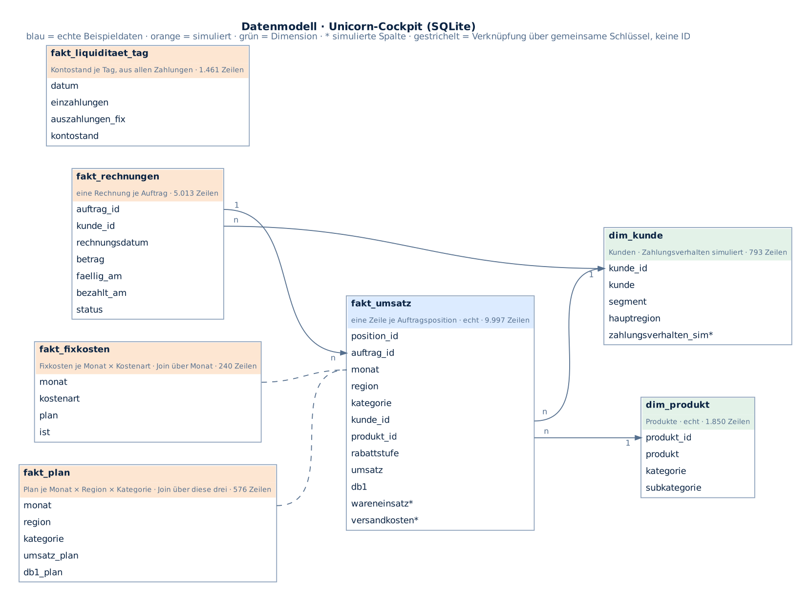

# Kennzahlen und Datenherkunft

[🇬🇧 English](metrics.md) · 🇩🇪 Deutsch

Alle Beträge in US-Dollar wie in der Quelle. „YTD“ = vom 1. Januar bis zum Stichtag (Monatsende).
Die Spalte **SQL** nennt die Abfrage im Ordner [`sql/`](../sql), die dieselbe Zahl direkt in der Datenbank rechnet
(automatisch gegen die App getestet).

## Kennzahlen

| Kennzahl | Definition | Zeitraum | SQL |
|---|---|---|---|
| **Umsatz** | Σ `umsatz` (nach Rabatt) | YTD | `01` |
| **DB I** (Deckungsbeitrag I) | Umsatz − Wareneinsatz − Versandkosten = Gewinnspalte der Quelle (`db1`) | YTD | `01` |
| **Marge** | DB I / Umsatz | YTD | `01` |
| **Fixkosten** | Personal + Miete + Marketing + IT & Verwaltung (Ist) | YTD | `01` |
| **EBIT** | DB I − Fixkosten (ohne Unternehmerlohn, Zinsen, Steuern) | YTD | `01` |
| **Abweichung gegen Plan** | Ist / Plan − 1; beim EBIT (Ist − Plan) / \|Plan\| | YTD | `01`, `03` |
| **Ampel** | grün ≥ Plan · gelb bis −5 % · rot darunter (Schwelle in der App einstellbar) | YTD | – |
| **Rabattstufe** | 0 % · 1–20 % · > 20 % Rabatt je Position | YTD | `02` |
| **DB-I-Brücke** | Mengen-, Mix- und Preis/Rabatt-Effekt, Segmente Region × Kategorie; Summe = DB I Ist − Plan | YTD | – |
| **Kontostand** | Startkasse + alle Ein- und Auszahlungen bis Stichtag | Stichtag | `05` |
| **Liquiditätspuffer** | 1 Monat Fixkosten (Plan) + Privatentnahme | nächster Monat | – |
| **13-Wochen-Prognose** | Kontostand fortgeschrieben: offene Rechnungen zum erwarteten Zahltag (Fälligkeit + bisheriger Verzug des Kunden), Neugeschäft laut Plan; Ware, Versand, Fixkosten laut Plan, Entnahme | 13 Wochen ab Stichtag | – |
| **Offene Forderungen** | Rechnungen bis Stichtag gestellt, am Stichtag nicht bezahlt, ohne uneinbringliche | Stichtag | `04` |
| **Forderungslaufzeit (DSO)** | offene Forderungen / Umsatz der letzten 12 Monate × 365 | 12 Monate | `04` |
| **Zahlungsverzug** | Zahltag − Fälligkeit in Tagen (nur Kunden mit Zahlungsziel) | – | `06` |
| **Kunde zahlt später** | Ø Verzug letzte 6 Monate − Ø Verzug der 12 Monate davor (nach Fälligkeit); Signal ab +20 Tagen | 18 Monate | `06` |
| **Break-even-Umsatz** | Fixkosten / Marge | 12 Monate | – |
| **Sicherheitsabstand** | (Umsatz − Break-even) / Umsatz | 12 Monate | – |

**Benchmark** (letzte 12 Monate, gegen U.S. Census Bureau, Annual Retail Trade Survey, Einzelhandel ohne Autohandel):

| Kennzahl | Unicorn | Branche |
|---|---|---|
| Rohertragsquote | (Umsatz − Wareneinsatz) / Umsatz | Rohertrag in % vom Umsatz |
| Umsatzrendite | EBIT / Umsatz | Rohertragsquote − Betriebskosten / Umsatz |
| Forderungslaufzeit | wie oben | Forderungen am Jahresende / Umsatz × 365 |
| Umsatzwachstum | Umsatz / Umsatz der 12 Monate davor − 1 (erst bei 12 vollen Vergleichsmonaten) | Umsatz / Vorjahr − 1 |

**Mandanten-Modus:** Die vier Regionen sind vier Mandanten. Umsatz, DB I und Rechnungen gehören zur Region;
Fixkosten, Entnahme und Startkasse werden nach Planumsatz verteilt. Die vier Mandanten ergeben zusammen genau die Firma.

## Woher die Daten kommen

| Teil | Herkunft | Echt oder simuliert |
|---|---|---|
| Aufträge, Positionen, Umsatz, Rabatt, Menge, DB I, Kunden, Produkte | Unicorn-Datenbank (PostgreSQL, Masterschool), Abfrage [`daten/erzeugung/cockpit_export.sql`](../daten/erzeugung/cockpit_export.sql) | **echt** (fiktiver Händler: Tableau „Sample Superstore“) |
| Aufteilung Wareneinsatz / Versandkosten | Versandsatz je Versandart (2–6 % vom Umsatz) | simuliert |
| Plan 2016–2019 | Vorjahres-Ist × Wachstumsziel je Region, Marge + Verbesserungsziel | simuliert |
| Fixkosten | Jahresbudget, Aufteilung nach Kostenart, Ist = Plan ± Zufall | simuliert |
| Rechnungen, Zahlungsziele, Zahlungseingänge | Ziel je Segment, festes Zahlungsverhalten je Kunde | simuliert |
| Kontostand je Tag | aus allen Zahlungsströmen | simuliert |

Erzeugt mit [`daten/erzeugung/gen_data.py`](../daten/erzeugung/gen_data.py) (Seed 42, reproduzierbar). Das Skript bricht ab,
wenn Zeilenzahl, Umsatz oder Gewinn nicht zur Quelle passen. Alle Annahmen im Detail:
[`daten/daten_dokumentation.md`](../daten/daten_dokumentation.md).

**Was das bedeutet:** Das Margenproblem durch Rabatte über 20 % steckt in den echten Daten. Die Planabweichung von
Central vergleicht echte Umsätze mit einem simulierten Plan. Fixkosten-, Verzugs- und Liquiditätssignale sind simuliert,
damit das Cockpit Frühwarnungen zeigen kann.

