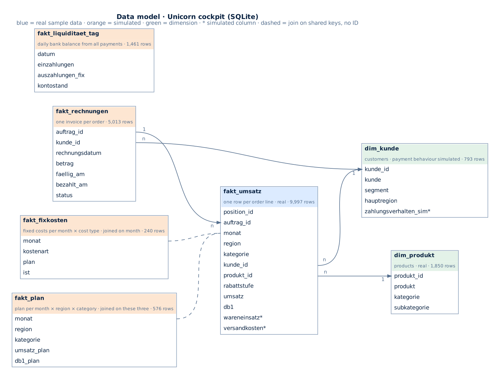

# Metrics and data origin

🇬🇧 English · [🇩🇪 Deutsch](kennzahlen.md)

All amounts in US dollars as in the source. "YTD" = 1 January to the reporting date (month end).
Column **SQL** names the query in [`sql/`](../sql) that computes the same figure directly in the database
(automatically tested against the app). Column names in the database are German.

## Metrics

| Metric | Definition | Period | SQL |
|---|---|---|---|
| **Revenue** | Σ `umsatz` (after discount) | YTD | `01` |
| **CM I** (contribution margin I) | revenue − cost of goods − shipping = the source's profit column (`db1`) | YTD | `01` |
| **Margin** | CM I / revenue | YTD | `01` |
| **Fixed costs** | staff + rent + marketing + IT & admin (actual) | YTD | `01` |
| **EBIT** | CM I − fixed costs (no owner's salary, interest or taxes) | YTD | `01` |
| **Variance vs. plan** | actual / plan − 1; for EBIT (actual − plan) / \|plan\| | YTD | `01`, `03` |
| **Traffic light** | green ≥ plan · amber down to −5 % · red below (threshold adjustable in the app) | YTD | – |
| **Discount level** | 0 % · 1–20 % · > 20 % discount per order line | YTD | `02` |
| **CM I bridge** | volume, mix and price/discount effect over region × category; sums to CM I actual − plan | YTD | – |
| **Bank balance** | opening cash + all inflows and outflows up to the reporting date | date | `05` |
| **Cash buffer** | one month of planned fixed costs + owner drawings | next month | – |
| **13-week forecast** | balance rolled forward: open invoices on their expected payment day (due date + the customer's past delay), new business per plan; goods, shipping, planned fixed costs, drawings | 13 weeks | – |
| **Open receivables** | invoices issued by the reporting date and unpaid on it, excluding uncollectible ones | date | `04` |
| **Days sales outstanding (DSO)** | open receivables / revenue of the last 12 months × 365 | 12 months | `04` |
| **Payment delay** | payment day − due date in days (customers with payment terms only) | – | `06` |
| **Customer pays later** | avg. delay last 6 months − avg. delay of the 12 months before (by due date); signal from +20 days | 18 months | `06` |
| **Break-even revenue** | fixed costs / margin | 12 months | – |
| **Margin of safety** | (revenue − break-even) / revenue | 12 months | – |

**Benchmark** (last 12 months, against Deutsche Bundesbank, retail excl. motor vehicles, WZ 47):

| Metric | Unicorn | Industry |
|---|---|---|
| Gross margin | (revenue − cost of goods) / revenue | 100 % − cost of materials |
| Staff cost ratio | staff costs / revenue | staff costs / total output |
| EBIT margin | EBIT / revenue | result before taxes / revenue |
| DSO | as above | trade receivables / revenue × 365 |
| Revenue growth | revenue / revenue of the prior 12 months − 1 (only with 12 full comparison months) | revenue / prior year − 1 |

**Client mode:** the four regions act as four clients. Revenue, CM I and invoices belong to the region; fixed costs,
drawings and opening cash are allocated by planned revenue. The four clients add up exactly to the company.

## Where the data comes from

| Part | Origin | Real or simulated |
|---|---|---|
| Orders, order lines, revenue, discount, quantity, CM I, customers, products | Unicorn database (PostgreSQL, Masterschool), query [`daten/erzeugung/cockpit_export.sql`](../daten/erzeugung/cockpit_export.sql) | **real** (fictional retailer: Tableau "Sample Superstore") |
| Split cost of goods / shipping | shipping rate per shipping mode (2–6 % of revenue) | simulated |
| Plan 2016–2019 | prior-year actual × growth target per region, margin + improvement target | simulated |
| Fixed costs | annual budget, split by cost type, actual = plan ± noise | simulated |
| Invoices, payment terms, payments | terms per segment, fixed payment behaviour per customer | simulated |
| Daily bank balance | from all payment flows | simulated |

Generated with [`daten/erzeugung/gen_data.py`](../daten/erzeugung/gen_data.py) (seed 42, reproducible). The script stops
if row count, revenue or profit do not match the source. All assumptions in detail (German):
[`daten/daten_dokumentation.md`](../daten/daten_dokumentation.md).

**What this means:** the margin problem from discounts above 20 % is in the real data. Central's plan gap compares real
revenue with a simulated plan. Fixed-cost, payment-delay and cash signals are simulated so the cockpit has early
warnings to show.

